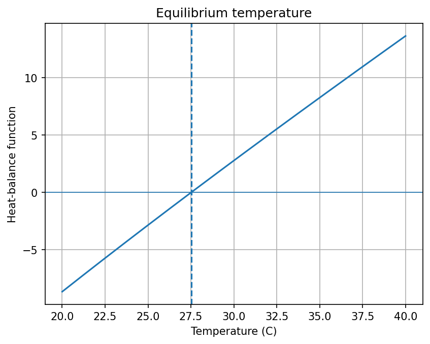

# Task 10: Root Finding: Bisection and Fixed-Point Methods

**Concept:** A root satisfies f(r) = 0. Bisection halves a sign-changing interval repeatedly; fixed-point iteration rewrites f(x) = 0 as x = g(x) and repeats xₙ₊₁ = g(xₙ).

**Files:** [`code/Task_10_bisection_fixed_point.py`](../code/Task_10_bisection_fixed_point.py) (given program) · [`code/Task_10_extension.py`](../code/Task_10_extension.py) (parameter change + new real-world case)

---

## 1. Inputs and mathematical operation

- **Input values:** f(T) = T − 25 − 10·e^(−T/20), bracket [20, 40], tolerance 10⁻¹⁰; for fixed-point, g(T) = 25 + 10·e^(−T/20) with start T = 30.
- **Mathematical operations:** repeated interval halving; repeated evaluation of g.

## 2. Output of the program

```text
Bisection equilibrium temperature: 27.525211 C
Bisection iterations: 38
Fixed-point equilibrium temperature: 27.525211 C
Fixed-point iterations: 13
```



## 3. Interpretation of the output

- Both methods find the equilibrium temperature **27.525211 °C**, where heat gain equals heat loss. Bisection needed **38** iterations; fixed-point iteration needed only **13** because g changes slowly near the root.
- **Graph:** the heat-balance curve rises through zero; the dashed vertical line marks the root at ≈ 27.5 °C. Below it f < 0 (more loss than gain, so the temperature rises) and above it f > 0.

## 4. Changing an input / parameter

**Change made:** the ambient temperature 25 → **35 °C**, and the bracket was widened from [20, 40] to [20, 200].

```text
ambient=25 C: bisection root=27.525211 C (39 its), fixed-point=27.525211 C (12 its)
ambient=35 C: bisection root=36.603829 C (39 its), fixed-point=36.603829 C (10 its)
Wider bracket [20, 200] for ambient 25: 41 bisection iterations
```

**How the result changes:** The equilibrium moves from 27.53 °C to **36.60 °C**: a warmer surrounding gives a warmer equilibrium. Bisection still needs about 39 iterations, and widening the bracket to 180 wide only adds about 2 iterations (≈ log₂ of the width ratio), showing bisection is slow but reliable. Fixed-point stays fast (10–12 iterations).

## 5. Modified program for a different but related real-world case

**Case:** Break-even production volume of a small factory

**New assumptions**

- Selling price 48 per unit. Monthly cost C(q) = 12,000 + 20q + 0.004q² (fixed cost, variable cost, and an overtime penalty that grows with volume).
- Profit(q) = 48q − C(q); the break-even points are where profit = 0.
- Fixed-point form: q = 12,000 / (48 − 20 − 0.004q).

**Input data:** Coefficients in `code/Task_10_extension.py`; brackets [100, 1000] and [3000, 6998].

**Output**

```text
Profit at q=100: -9240.0 | at q=2000: 28000.0
First break-even volume : 458.62 units (37 bisection steps)
Second break-even volume: 6541.38 units
Fixed-point break-even  : 458.62 units
Profit at q = [0, 1000, 2000, 3000, 4000, 5000, 6000, 7000] -> [-12000, 12000, 28000, 36000, 36000, 28000, 12000, -12000]
```

**Interpretation:** There are **two** break-even points: the factory begins to make a profit at **458.6 units/month** (confirmed by bisection and fixed-point) and falls back into loss above **6,541 units/month** when the quadratic cost term dominates. Profit is largest around 3,500 units (≈ 37,000). A sign change was needed to bracket each root separately.
