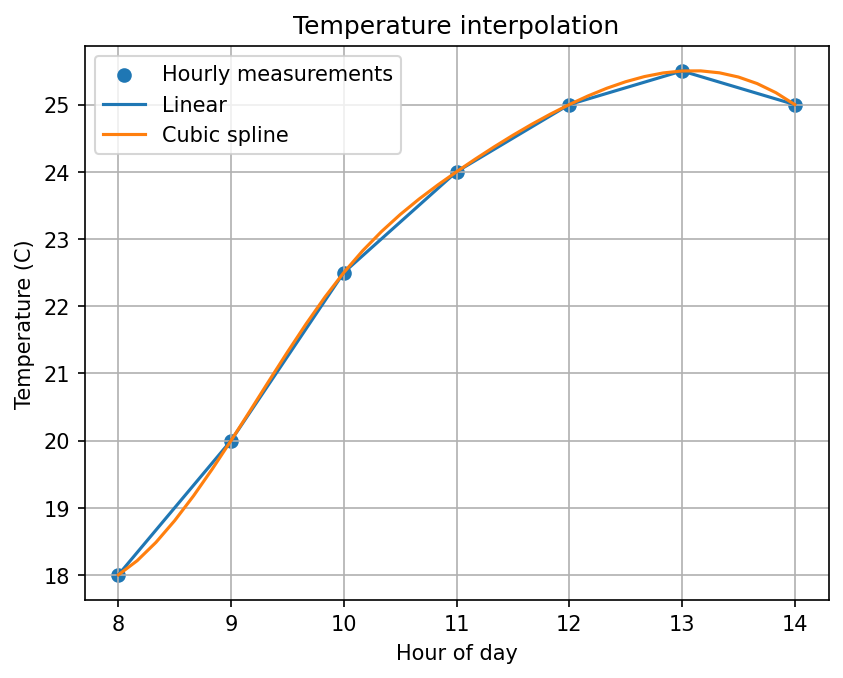
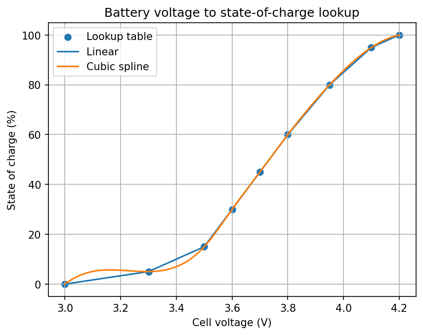

# Task 13: Interpolation

**Concept:** Interpolation estimates values between known points. Linear interpolation joins neighbouring points with straight lines; a cubic spline uses smooth cubic pieces.

**Files:** [`code/Task_13_interpolation.py`](../code/Task_13_interpolation.py) (given program) · [`code/Task_13_extension.py`](../code/Task_13_extension.py) (parameter change + new real-world case)

---

## 1. Inputs and mathematical operation

- **Input values:** hourly temperatures from 08:00 to 14:00 (18.0 → 25.0 °C) and the target times every 10 minutes.
- **Mathematical operations:** `interp1d` (linear) and `CubicSpline`, evaluated at the 10-minute times and at 10:30.

## 2. Output of the program

```text
Linear estimate at 10:30: 23.25 C
Cubic estimate at 10:30:  23.36 C
```



## 3. Interpretation of the output

- At 10:30 the linear estimate is **23.25 °C** (the average of 22.5 and 24.0) and the cubic estimate is **23.36 °C**.
- **Graph:** dots are the real hourly measurements. The linear estimate is a zig-zag of straight segments with sharp corners at each measurement; the cubic curve is smooth and bends over naturally as the temperature levels off around 13:00 (25.5 °C). Both pass through every measurement. The two differ by about 0.1 °C here, but the spline better follows real physical behaviour.

## 4. Changing an input / parameter

**Change made:** the sampling interval of a known curve was changed from 1 hour to 2 and 3 hours.

```text
samples every 1.0 h: max error linear=0.0509 C, cubic=0.0008 C
samples every 2.0 h: max error linear=0.1975 C, cubic=0.0144 C
samples every 3.0 h: max error linear=0.4223 C, cubic=0.1412 C
```

**How the result changes:** When measurements are spaced further apart, both methods become less accurate: the maximum error of linear interpolation grows from 0.05 °C to 0.42 °C, and the cubic spline's from 0.0008 °C to 0.14 °C. The cubic spline is far better on smooth data (about 60× more accurate at 1 h), but denser measurements help both.

## 5. Modified program for a different but related real-world case

**Case:** Battery state-of-charge from measured voltage (lookup table)

**New assumptions**

- A Li-ion cell has a nonlinear voltage-to-charge relationship supplied as a 9-point table (3.00 V = 0 %, 4.20 V = 100 %).
- The table is monotonic, so voltage can be used as the interpolation variable x and the charge as y.
- Measured voltages: 3.45 V, 3.75 V and 4.00 V.

**Input data:** `volt` and `soc` arrays in `code/Task_13_extension.py` (illustrative values, not from a specific datasheet).

**Output**

```text
Measured 3.45 V -> linear SOC=12.5 %, cubic SOC=10.0 %
Measured 3.75 V -> linear SOC=52.5 %, cubic SOC=52.5 %
Measured 4.00 V -> linear SOC=85.0 %, cubic SOC=85.7 %
```



**Interpretation:** A battery-management system cannot store every voltage, so it interpolates the table. 3.75 V gives **52.5 %** with both methods, but at 3.45 V the estimates differ (12.5 % linear vs 10.0 % cubic) because the table is strongly curved there. The graph shows the nonlinear S-shape of the battery: the cubic spline follows it smoothly while the straight-line version has visible corners.
