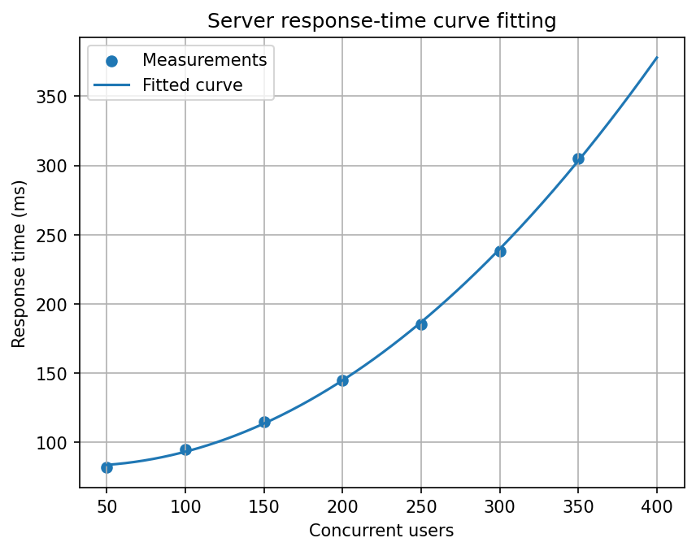
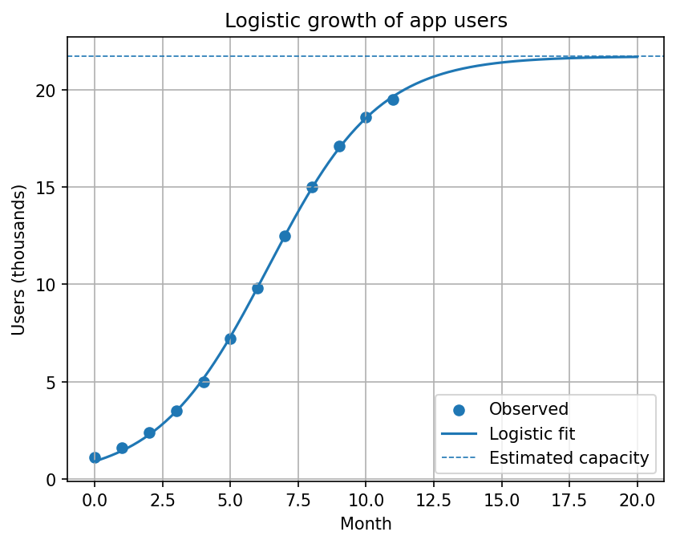

# Task 14: Curve Fitting and Approximation

**Concept:** Curve fitting chooses parameters so a model follows data as closely as possible by minimising the sum of squared residuals Σ(yᵢ − ŷᵢ)².

**Files:** [`code/Task_14_curve_fitting.py`](../code/Task_14_curve_fitting.py) (given program) · [`code/Task_14_extension.py`](../code/Task_14_extension.py) (parameter change + new real-world case)

---

## 1. Inputs and mathematical operation

- **Input values:** 7 measurements of concurrent users (50 to 350) and response time (82 to 305 ms).
- **Mathematical operations:** least-squares fit of y = ax² + bx + c using `curve_fit`; RMSE = √mean((y − ŷ)²); prediction at 400 users.

## 2. Output of the program

```text
Fitted model: y = 0.002167x^2 + -0.1345x + 85.00
RMSE: 1.55 ms
Predicted response at 400 users: 377.86 ms
```



## 3. Interpretation of the output

- The fitted model is **y = 0.002167x² − 0.1345x + 85.00**; the RMSE of **1.55 ms** means the curve is on average about 1.5 ms away from the measurements, which is very close. The model predicts **377.9 ms at 400 users**.
- **Graph:** the orange curve passes almost through all the dots and bends upward: response time increases slowly at low load but much faster at high load (the server is nearing saturation). The prediction for 400 users is an *extrapolation* beyond the data, so it should be treated with caution.

## 4. Changing an input / parameter

**Change made:** the model was changed from quadratic to a straight line (degree 1) and a cubic (degree 3).

```text
degree 1: RMSE=18.83 ms, prediction at 400 users=312.9 ms
degree 2: RMSE=1.55 ms, prediction at 400 users=377.9 ms
degree 3: RMSE=0.14 ms, prediction at 400 users=387.9 ms
```

**How the result changes:** The straight line is a poor model (RMSE 18.8 ms) because the data curve upward, and it predicts only 312.9 ms at 400 users, which is too optimistic. The cubic has a tiny RMSE (0.14 ms) but with only 7 points and 4 parameters it risks *over-fitting* and gives a different forecast (387.9 ms). The quadratic is a sensible compromise.

## 5. Modified program for a different but related real-world case

**Case:** Logistic growth of mobile-app users

**New assumptions**

- Monthly active users (thousands) over 12 months follow S-shaped growth that levels off at a capacity K: users(t) = K / (1 + e^(−r(t − t₀))).
- The data are illustrative (made up for this exercise), not real company data.
- Initial guesses K = 20, r = 0.5, t₀ = 6.

**Input data:** `month` and `users_k` arrays in `code/Task_14_extension.py`.

**Output**

```text
Capacity K=21.71k (+/-0.22), growth rate r=0.489/month, midpoint t0=6.38 months
RMSE=0.114k users
Forecast month 15: 21.40k users; month 24: 21.71k users
```



**Interpretation:** The fit estimates a market capacity of **K ≈ 21.7 thousand users** (±0.22), growth rate r = 0.49 per month, and a mid-point (fastest growth) at month 6.4. RMSE = 0.11 thousand users. The forecasts are 21.4 thousand at month 15 and 21.7 thousand at month 24, so growth is nearly complete. The graph shows the typical S-curve and the dashed capacity line.
