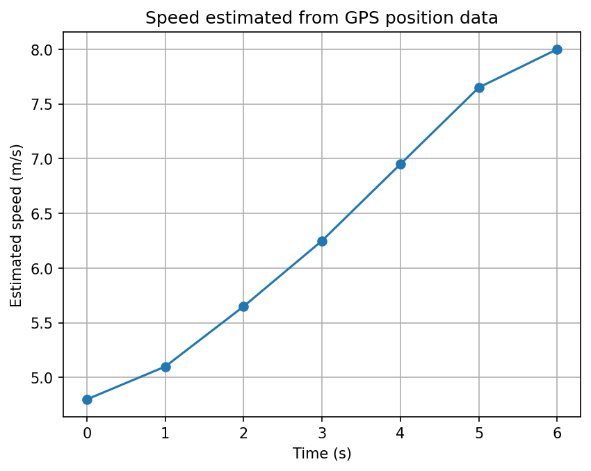
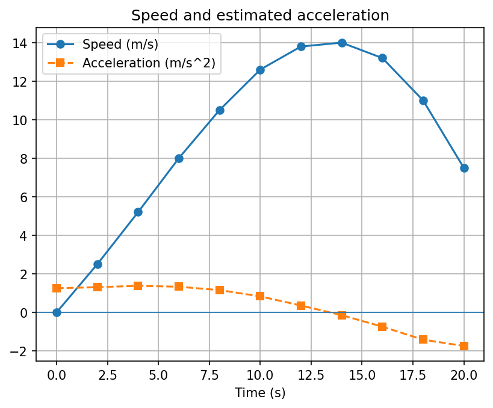

# Task 15: Numerical Differentiation

**Concept:** A derivative is approximated from nearby values: forward difference [f(x+h) − f(x)]/h, central difference [f(x+h) − f(x−h)]/(2h).

**Files:** [`code/Task_15_numerical_differentiation.py`](../code/Task_15_numerical_differentiation.py) (given program) · [`code/Task_15_extension.py`](../code/Task_15_extension.py) (parameter change + new real-world case)

---

## 1. Inputs and mathematical operation

- **Input values:** GPS positions (0 to 38 m) at times 0–6 s.
- **Mathematical operation:** speed = Δposition/Δtime; forward difference at the first point, central differences inside, backward difference at the last point.

## 2. Output of the program

```text
t=0s, position=0.0m, estimated speed=4.80m/s
t=1s, position=4.8m, estimated speed=5.10m/s
t=2s, position=10.2m, estimated speed=5.65m/s
t=3s, position=16.1m, estimated speed=6.25m/s
t=4s, position=22.7m, estimated speed=6.95m/s
t=5s, position=30.0m, estimated speed=7.65m/s
t=6s, position=38.0m, estimated speed=8.00m/s
```



## 3. Interpretation of the output

- The estimated speed rises steadily from **4.8 m/s** to **8.0 m/s** (17 to 29 km/h): the vehicle is accelerating by roughly 0.6 m/s every second.
- **Graph:** an upward-sloping line of speed against time. The end points use one-sided differences and are less accurate than the middle points, which use neighbours on both sides.

## 4. Changing an input / parameter

**Change made:** the step size h was varied from 10⁻¹ down to 10⁻¹² when differentiating sin(x) at x = 1 (exact derivative cos 1).

```text
h=1e-01: forward error=4.29e-02, central error=9.00e-04
h=1e-03: forward error=4.21e-04, central error=9.01e-08
h=1e-05: forward error=4.21e-06, central error=1.11e-11
h=1e-08: forward error=2.97e-09, central error=2.58e-09
h=1e-12: forward error=4.32e-05, central error=1.23e-05
```

**How the result changes:** The error first *decreases* with h (forward error is proportional to h; the central error is proportional to h², making it far more accurate: 10⁻¹¹ at h = 10⁻⁵). But for very small h (10⁻⁸ and below) round-off error takes over and the error rises again (about 10⁻⁵ at h = 10⁻¹²). There is an optimal step size and smaller is not always better.

## 5. Modified program for a different but related real-world case

**Case:** Acceleration of a bus from its speed readings

**New assumptions**

- Speed is sampled every 2 s for 20 s as a bus leaves a stop, cruises, then brakes.
- `np.gradient` is used (central differences inside, one-sided at the ends).
- Data are illustrative.

**Input data:** `t` and `v` arrays in `code/Task_15_extension.py`.

**Output**

```text
t=   0 s  speed=  0.0 m/s  acceleration=  1.25 m/s^2
t=   2 s  speed=  2.5 m/s  acceleration=  1.30 m/s^2
t=   4 s  speed=  5.2 m/s  acceleration=  1.38 m/s^2
t=   6 s  speed=  8.0 m/s  acceleration=  1.32 m/s^2
t=   8 s  speed= 10.5 m/s  acceleration=  1.15 m/s^2
t=  10 s  speed= 12.6 m/s  acceleration=  0.83 m/s^2
t=  12 s  speed= 13.8 m/s  acceleration=  0.35 m/s^2
t=  14 s  speed= 14.0 m/s  acceleration= -0.15 m/s^2
t=  16 s  speed= 13.2 m/s  acceleration= -0.75 m/s^2
t=  18 s  speed= 11.0 m/s  acceleration= -1.42 m/s^2
t=  20 s  speed=  7.5 m/s  acceleration= -1.75 m/s^2
Max acceleration 1.38 m/s^2 at t=4 s; hardest braking -1.75 m/s^2 at t=20 s
```



**Interpretation:** The bus accelerates at about 1.2–1.4 m/s² for the first 8 s, the acceleration drops to zero near t = 14 s (top speed 14 m/s ≈ 50 km/h), and then becomes negative: braking reaches about **−1.75 m/s²** at the end. On the graph the acceleration curve crosses zero exactly where the speed curve peaks. Such figures show passenger comfort (values near 1.5 m/s² are comfortable; harsh braking is higher).
