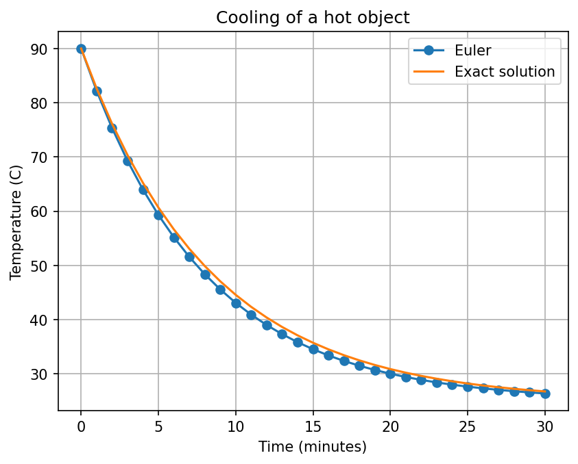
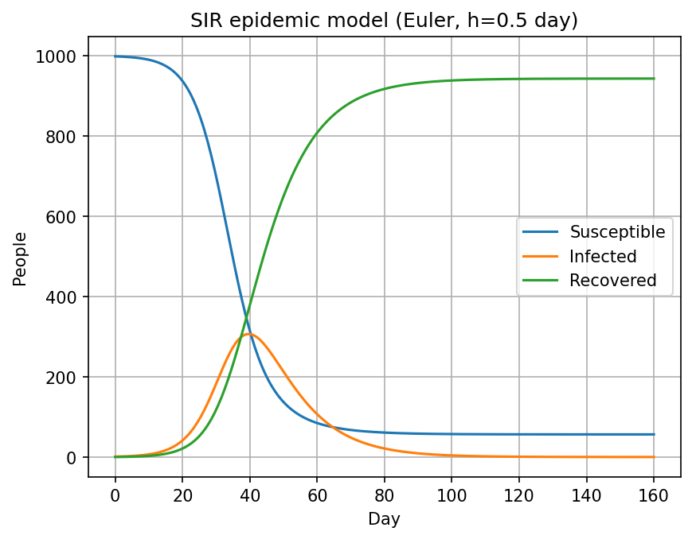

# Task 17: Ordinary Differential Equations: Euler Method

**Concept:** For dy/dt = f(t, y), Euler's method steps forward: yₙ₊₁ = yₙ + h·f(tₙ, yₙ). A smaller step h gives better accuracy at a higher computational cost.

**Files:** [`code/Task_17_euler_ode.py`](../code/Task_17_euler_ode.py) (given program) · [`code/Task_17_extension.py`](../code/Task_17_extension.py) (parameter change + new real-world case)

---

## 1. Inputs and mathematical operation

- **Input values:** ambient temperature 25 °C, initial temperature 90 °C, cooling constant k = 0.12 per minute, step h = 1 min, total time 30 min.
- **Mathematical operation:** Euler update T ← T + h·(−k(T − 25)), compared with the exact T = 25 + 65e^(−kt).

## 2. Output of the program

```text
Euler temperature after 30 min: 26.40 C
Exact temperature after 30 min: 26.78 C
Final absolute error: 0.3720 C
```



## 3. Interpretation of the output

- After 30 minutes Euler gives **26.40 °C** and the exact answer is **26.78 °C**, an error of 0.37 °C.
- **Graph:** both curves decay quickly at first then flatten towards 25 °C (the object approaches room temperature). The Euler markers lie just below the exact curve because Euler uses the slope at the start of each step, which is steeper than the average slope over the step.

## 4. Changing an input / parameter

**Change made:** the step size h was changed to 10, 5 and 0.1 min, and then to 20 min.

```text
h=10.0: Euler T(30)=  24.480 C, error=2.2960 C
h= 5.0: Euler T(30)=  25.266 C, error=1.5098 C
h= 1.0: Euler T(30)=  26.404 C, error=0.3720 C
h= 0.1: Euler T(30)=  26.738 C, error=0.0383 C
h=20 (unstable, 2 steps -> t=40 min): 152.4 C  (should be near 25 C!)
```

**How the result changes:** The error falls roughly in proportion to h (0.37 °C at h = 1 → 0.038 °C at h = 0.1), as expected for a first-order method. With h = 10 the error is 2.3 °C. With h = 20 the factor (1 − kh) = −1.4 has magnitude greater than 1, so the solution *oscillates and grows* (152 °C!) instead of cooling: the method is **unstable** for steps that are too large.

## 5. Modified program for a different but related real-world case

**Case:** SIR epidemic model (Susceptible-Infected-Recovered)

**New assumptions**

- Population 1,000 with 1 initial infection; infection rate β = 0.30/day and recovery rate γ = 0.10/day (basic reproduction number R₀ = β/γ = 3).
- Equations: dS/dt = −βSI/N, dI/dt = βSI/N − γI, dR/dt = γI; no births, deaths or vaccination, and the population is mixed uniformly.
- Euler step h = 0.5 day over 160 days.

**Input data:** Parameters at the top of the SIR section of `code/Task_17_extension.py`.

**Output**

```text
Peak infections: 307 people on day 39.5
Total ever infected (final R): 944 of 1000 (94.4%)
Susceptible left: 56
```



**Interpretation:** Infections rise slowly, peak at about **307 people on day 39.5**, and then decline as fewer susceptible people remain. In the end about **944 of 1,000 (94 %)** are infected at some point and 56 stay uninfected. The graph shows the susceptible curve falling, the recovered curve rising, and a bell-shaped infected curve. Reducing β (distancing) would lower and delay the peak.
