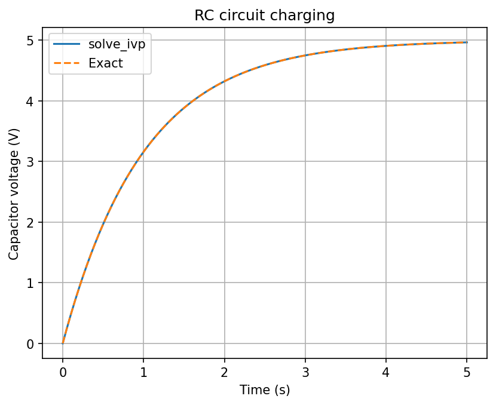
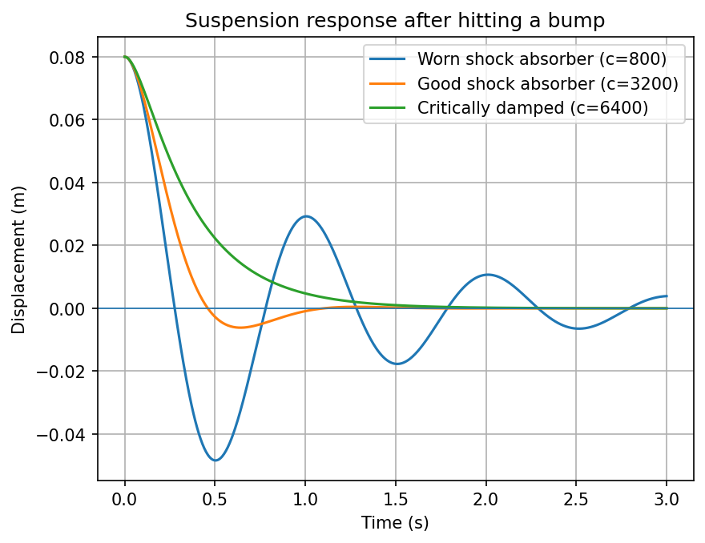

# Task 18: Numerical Solution of ODEs Using SciPy

**Concept:** `scipy.integrate.solve_ivp` uses higher-order adaptive solvers (default RK45) that automatically choose step sizes to meet a requested accuracy.

**Files:** [`code/Task_18_scipy_ode.py`](../code/Task_18_scipy_ode.py) (given program) · [`code/Task_18_extension.py`](../code/Task_18_extension.py) (parameter change + new real-world case)

---

## 1. Inputs and mathematical operation

- **Input values:** Vs = 5 V, R = 1000 Ω, C = 0.001 F (so RC = 1 s), V₀ = 0 V, time 0–5 s, tolerances rtol = 10⁻⁹ and atol = 10⁻¹¹.
- **Mathematical operation:** solve dV/dt = (Vs − V)/(RC); the exact solution is V = Vs(1 − e^(−t/RC)).

## 2. Output of the program

```text
Solver success: True
Capacitor voltage at 5 s: 4.9663 V
Maximum error against exact solution: 9.282e-10 V
```



## 3. Interpretation of the output

- The capacitor reaches **4.966 V after 5 s** (99.3 % of 5 V). The maximum difference from the exact formula is only **9 × 10⁻¹⁰ V**.
- **Graph:** the voltage rises quickly at first and then levels off at 5 V; the numerical (solid) and exact (dashed) curves are on top of each other. At t = RC = 1 s the voltage is 63.2 % of the supply.

## 4. Changing an input / parameter

**Change made:** the resistance and capacitance were changed: (1000 Ω, 0.5 mF) and (2000 Ω, 1 mF).

```text
R=1000 ohm, C=0.001 F: tau=1.0000 s, V(tau)=3.161 V (63.2% of 5 = 3.161), V(5 s)=4.9663 V
R=1000 ohm, C=0.0005 F: tau=0.5000 s, V(tau)=3.161 V (63.2% of 5 = 3.161), V(5 s)=4.9998 V
R=2000 ohm, C=0.001 F: tau=2.0000 s, V(tau)=3.161 V (63.2% of 5 = 3.161), V(5 s)=4.5896 V
```

**How the result changes:** The time constant τ = RC controls the speed: τ = 0.5 s charges almost fully by 5 s (4.9998 V), while τ = 2 s is slower (4.59 V at 5 s). In all cases the voltage is 63.2 % of 5 V (3.161 V) at t = τ.

## 5. Modified program for a different but related real-world case

**Case:** Car suspension: a second-order ODE (mass-spring-damper)

**New assumptions**

- Quarter-car mass m = 400 kg, spring constant k = 16,000 N/m, initial bump displacement 0.08 m, initial velocity 0.
- m·x″ + c·x′ + k·x = 0, rewritten as two first-order equations for x and v = x′ so `solve_ivp` can solve it.
- Three damping values: worn (c = 800), good (c = 3200) and critical (c = 6400 N·s/m; the critical value is 2√(km) ≈ 5060).

**Input data:** Parameters in `code/Task_18_extension.py`.

**Output**

```text
Critical damping coefficient: 5060 N s/m
c=800: damping ratio=0.16, min displacement=-0.0484 m, time to settle within 4 mm = 2.66 s
c=3200: damping ratio=0.63, min displacement=-0.0062 m, time to settle within 4 mm = 0.81 s
c=6400: damping ratio=1.26, min displacement=0.0000 m, time to settle within 4 mm = 1.05 s
```



**Interpretation:** - **Worn shock absorber** (damping ratio 0.16): the car bounces to −0.048 m on the rebound and takes 2.7 s to settle.
- **Good damping** (ratio 0.63): one small rebound (−6 mm) and settles in 0.8 s: the best comfort-and-control compromise.
- **Over-damped** (ratio 1.26): no oscillation at all but slower recovery (1.05 s).

The graph makes these three behaviours visible: a long wobbling curve, a quickly settling curve, and a smooth non-oscillating one.
