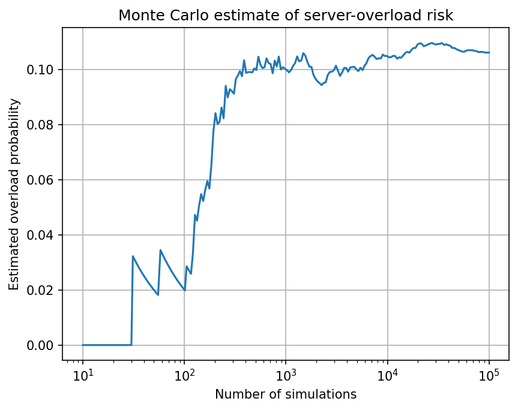
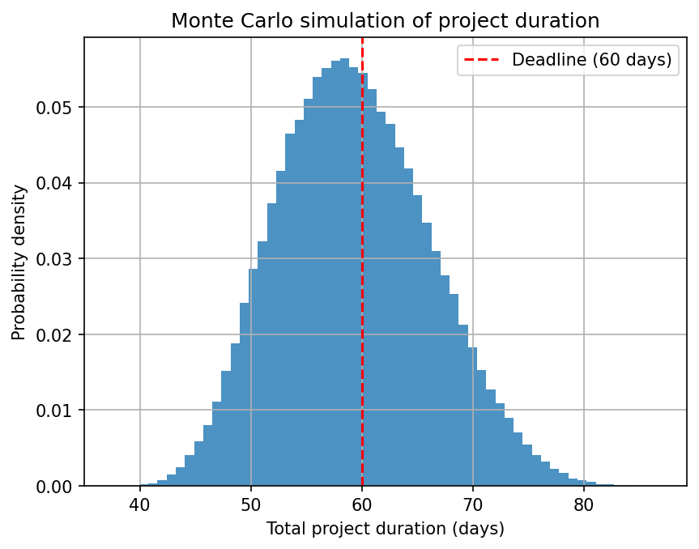

# Task 20: Random Numbers and Monte Carlo Methods

**Concept:** Monte Carlo methods estimate quantities by repeated random sampling: the fraction of simulations in which an event occurs approaches its probability as N grows.

**Files:** [`code/Task_20_monte_carlo.py`](../code/Task_20_monte_carlo.py) (given program) · [`code/Task_20_extension.py`](../code/Task_20_extension.py) (parameter change + new real-world case)

---

## 1. Inputs and mathematical operation

- **Input values:** server capacity 1000, mean demand 850, standard deviation 120 (normal distribution), N = 100,000 simulations, seed 42.
- **Mathematical operation:** generate random demands, test demand > capacity, and take the fraction as the overload probability.

## 2. Output of the program

```text
Estimated overload probability: 10.6160%
Number of overload cases: 10616 out of 100000
```



## 3. Interpretation of the output

- About **10.6 %** of the scenarios overload the server (10,616 of 100,000). The exact normal-distribution value is 10.57 %, so the simulation is very accurate.
- **Graph:** the horizontal axis is logarithmic. With few simulations the estimate jumps around widely; as N reaches thousands, it settles near 0.106. This shows the law of large numbers: more samples → a more stable estimate.

## 4. Changing an input / parameter

**Change made:** capacity 1000 → 1100, standard deviation 120 → 180, and N 100,000 → 1,000.

```text
capacity=1000, sd=120, N=100,000: simulated=10.6160%, exact normal tail=10.5650%
capacity=1100, sd=120, N=100,000: simulated=1.9120%, exact normal tail=1.8610%
capacity=1000, sd=180, N=100,000: simulated=20.2210%, exact normal tail=20.2328%
capacity=1000, sd=120, N=  1,000: simulated=10.1000%, exact normal tail=10.5650%
```

**How the result changes:** More capacity cuts the risk to 1.9 %. A larger variability raises it to 20.2 % even though the average demand is unchanged. With only 1,000 simulations the estimate (10.1 %) is noticeably less accurate than with 100,000 (10.6 %); the error shrinks like 1/√N.

## 5. Modified program for a different but related real-world case

**Case:** Project deadline risk (three-stage software project)

**New assumptions**

- Stage durations in days follow triangular distributions (min, most likely, max): Design (8, 12, 20), Build (20, 28, 45), Test (8, 12, 25).
- Stages run one after another and are independent. The deadline is 60 days.
- 200,000 simulated projects.

**Input data:** `stages` dictionary in `code/Task_20_extension.py`.

**Output**

```text
Mean total duration: 59.32 days (std 6.82)
Probability of finishing within 60 days: 55.62%
Probability of missing the deadline: 44.38%
90th percentile duration: 68.5 days
```



**Interpretation:** The average total is 59.3 days with a standard deviation of 6.8, so there is only a **55.6 %** chance of finishing within 60 days and a **44.4 %** chance of missing it, even though the mean is just below the deadline (the distribution is skewed to the right: delays are longer than savings). The 90th percentile is 68.5 days, so a safer schedule promise would be about 69 days. The histogram shows a right-skewed bell shape with the deadline line cutting it near the middle.
